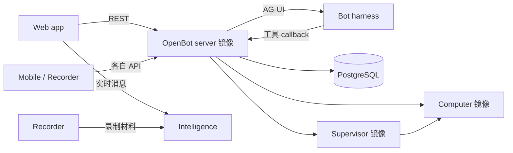

# 代码与系统边界

本页提供修改入口，不重复 [Architecture](../architecture.md) 的部署端口和完整运行说明。

## 仓库范围

| 区域 | 可直接查看的内容 | 常见修改入口 |
| --- | --- | --- |
| `app/` | Web 页面、业务读写、缓存与组件 | [routes](../../app/src/routes)、[lib](../../app/src/lib)、[components](../../app/src/components) |
| `shared/` | 多调用方使用的工具名、类型、结果解释、提示和规则 | [orchestration](../../shared/orchestration.ts)、[learning](../../shared/learning.ts)、[tool-steps](../../shared/tool-steps.ts) |
| `api/` | REST 与实时协议、约束检查 | [区域源文件](../../api/openapi)、[AsyncAPI](../../api/asyncapi.yaml) |
| `agent-*` | 各框架 Bot 的接入代码；不同框架需分别核验 | [LangGraph main](../../agent-langgraph-agui/src/main.py)、[工具运行时](../../agent-langgraph-agui/src/tool_runtime.py)、[共享契约测试辅助](../../shared/harness_contract.py) |
| `desktop/` | 桌面安装、更新、宿主机能力、凭据集成 | [Rust 源码](../../desktop/src-tauri/src)、[已有桌面文档](../desktop-install.md) |
| `extension/` | Recorder 浏览器扩展 | [扩展源码](../../extension/src)、[录制共享类型](../../shared/recorder-api.ts) |
| `mobile/` | 移动端及生成 API 客户端 | [移动端目录](../../mobile) |
| `scripts/` | 本地启停、配置生成、测试编排、发布与升级 | [start](../../scripts/start.sh)、[update](../../scripts/update.ts)、[test-ci](../../scripts/test-ci.ts) |

server、computer 和 supervisor 主要由 [docker-compose.yml](../../docker-compose.yml) 引用发布镜像；不能从 API 客户端定位到本仓库中的实际 handler 或 SQL migration。协议声明与已有说明足以识别职责边界，不足以审计全部服务端实现。

这幅图是 Compose、harness 和协议说明的组合视图，不表示各条连接都在本次运行中被观测。证据：[Compose](../../docker-compose.yml)、[tool_runtime](../../agent-langgraph-agui/src/tool_runtime.py)、[AsyncAPI](../../api/asyncapi.yaml)、[录制目的地声明](../../shared/recorder-disclosure.ts)。

## 按问题定位

| 要改的行为 | 起点 | 要同时检查 |
| --- | --- | --- |
| Bot 显示、隔离、授权入口 | [agents](../../app/src/lib/agents) | [bots API](../../api/openapi/bots.yaml)、[grants API](../../api/openapi/bot-grants.yaml) |
| 创建 Routine / Goal / Check-in | [plan](../../app/src/lib/routines/plan.ts)、[mutations](../../app/src/lib/routines/mutations.ts) | [统一列表](../../app/src/lib/routines/merged.ts)、[schedules API](../../api/openapi/schedules.yaml) |
| Task 状态及列表 | [tasks](../../app/src/lib/tasks) | [conversations API](../../api/openapi/conversations.yaml)、对话实时 busy |
| App 账户和共享授权 | [plugins](../../app/src/lib/plugins)、[connections](../../app/src/lib/connections) | [apps API](../../api/openapi/apps.yaml)、[connections API](../../api/openapi/connections.yaml)、[approvals API](../../api/openapi/approvals.yaml) |
| 审批文案与持续许可 | [approval-outcomes](../../shared/approval-outcomes.ts)、[standing-rule](../../shared/standing-rule.ts) | [approvals API](../../api/openapi/approvals.yaml)、已有 [Approvals](../approvals.md) |
| 记忆与学习展示 | [memory](../../app/src/lib/memory.ts)、[learning types](../../shared/learning.ts) | [memory API](../../api/openapi/memory.yaml)、[learning API](../../api/openapi/learning.yaml) |
| 组织切换或数据串用 | [current](../../app/src/lib/organizations/current.ts)、[query-client](../../app/src/query-client.ts) | [组织读取](../../app/src/lib/organizations/queries.ts)、[切换](../../app/src/lib/organizations/mutations.ts) |
| REST 返回值或错误显示 | [apiRequest](../../app/src/lib/api/request.ts)、[client](../../app/src/lib/client.ts) | 区域 API 源文件及三个客户端的生成配置 |

## 前端边界

业务模块封装 query/mutation，页面消费查询结果和计划。API mutator 统一使用 clientRequest，204、CSV 和 JSON 分开处理，错误使用服务端信息或调用方 fallback。请求归属在调用时读取当前组织，而不是在模块初始化时固定。

实时事件和 REST 查询不是相互替代的两份状态定义：对话查询保留持久 work，事件提供 busy 等即时信息；Task 列表再结合实时 busy 决定显示状态。证据：[channel queries](../../app/src/lib/channels/queries.ts)、[Task queries](../../app/src/lib/tasks/queries.ts)、[request](../../app/src/lib/api/request.ts)。
