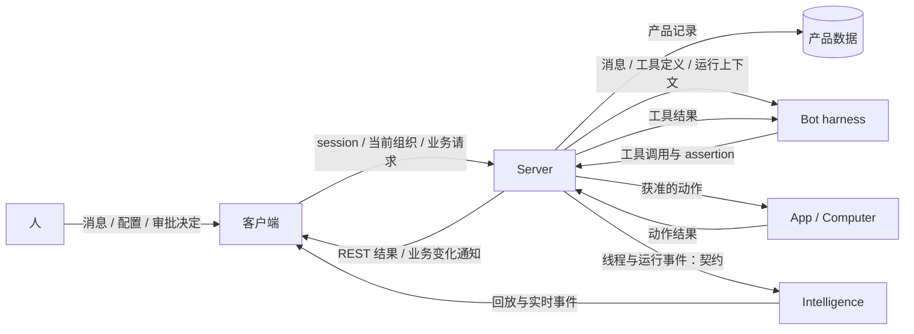
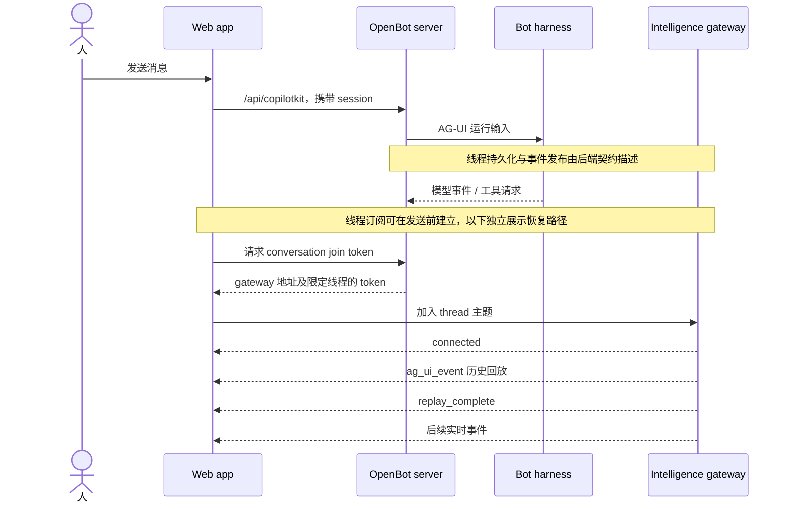
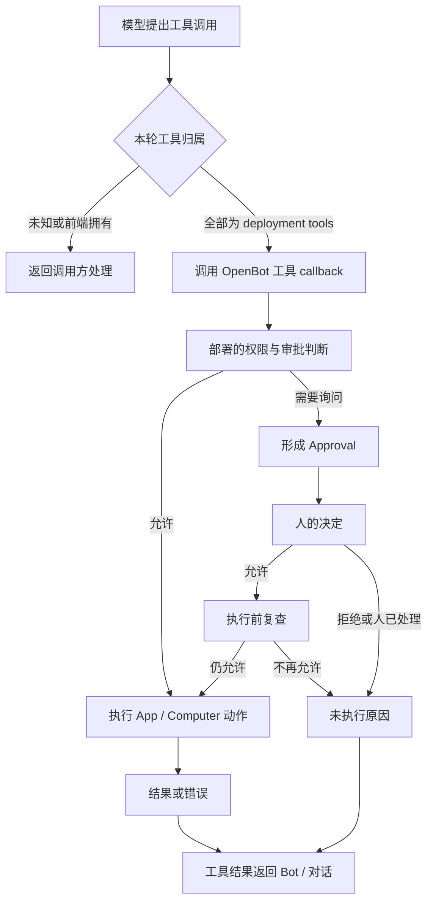
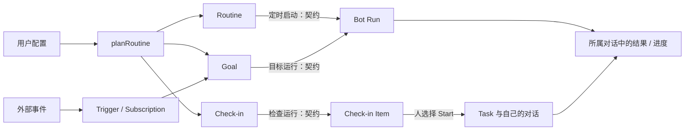
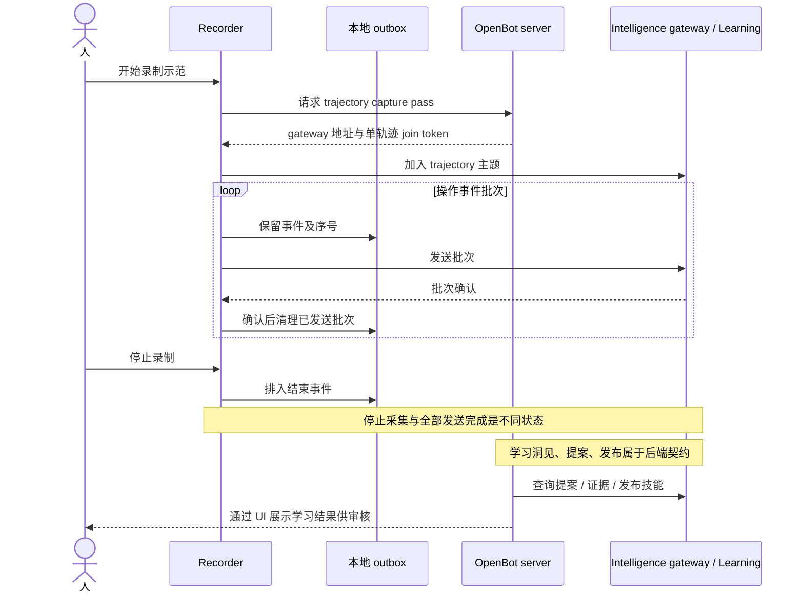

# 数据流程图

已渲染图像：[交互图集](rendered/index.html) · [渲染与检查说明](rendered/README.md)。

本页按数据载荷和通道区分流程。流程图代表代码或契约中的路径，不声称已在运行部署中抓包验证；服务端持久化的内部顺序不从图中推断。

## 一级数据流：请求、执行与结果

聊天回复、产品列表和屏幕画面是不同数据流，不能用一个“WebSocket 返回结果”概括。依据：[provider](../../app/src/lib/copilot/provider.tsx)、[tool runtime](../../agent-langgraph-agui/src/tool_runtime.py)、[REST API](../../api/README.md)、[AsyncAPI](../../api/asyncapi.yaml)。图中持久化箭头表示服务职责，不规定事件写入与广播的事务顺序。

## 聊天执行与线程回放

join token 限定一个线程；协议要求每次重连申请新 token。事件携带 ID，重连可提供最后已见 ID，并丢弃已绘制事件。`replay_failed` 要求 REST 恢复消息后重连；token 过期也需重新取 token。以上为 [threadStream 契约](../../api/asyncapi.yaml)，不意味着本页已验证 SDK 的每种恢复分支。

Web 的 `joinWithin` 本地实现会在截止时间评估是否继续等待正在输出且可达的运行；放弃连接后还给 detach 一个有界宽限，避免页面永久等候。证据：[join-thread](../../app/src/lib/copilot/join-thread.ts)、[provider](../../app/src/lib/copilot/provider.tsx)、[conversation API](../../api/openapi/conversations.yaml)。

## 工具执行与审批

工具归属和 callback 可在 [LangGraph tool_runtime](../../agent-langgraph-agui/src/tool_runtime.py) 核验；权限、审批和复查属于 [Approval API](../../api/openapi/approvals.yaml) 与 [共享结果契约](../../shared/approval-outcomes.ts)。图中不指定权限内部规则的完整执行顺序；一次批准也不保证执行成功。结果未知时应先核实，不直接再次执行。

## 主动与持续工作

Plan 和创建补偿由前端实现；定时器、事件接收和任务执行位于服务端契约内。本图省略 Goal 关联定时 Routine 的细节，见 [完整业务流程](flows.md#创建例行安排)。证据：[plan](../../app/src/lib/routines/plan.ts)、[mutations](../../app/src/lib/routines/mutations.ts)、[schedules API](../../api/openapi/schedules.yaml)。

## Recorder 与学习数据

录制数据从 Recorder 直达 Intelligence；OpenBot 发许可并接收录制状态，不能把完整录制画成经 server 中转。无确认的批次可以重发，协议按事件序号去重；本地 outbox 和停止后的 drained 状态处理见 [streamer](../../extension/src/offscreen/streamer.ts)、[outbox](../../extension/src/offscreen/outbox.ts)。地址与许可检查见 [grant](../../extension/src/offscreen/grant.ts)，协议见 [trajectoryCapture](../../api/asyncapi.yaml)。

学习数据的可见结果为带证据的 Insight、Proposal 和 Skill 文件；并非浏览器直接修改 Bot 的模型参数。个人审核、自动批准和共享范围见 [learning](../../shared/learning.ts)。

## 通道与数据载荷速查

| 通道 | 主要载荷 | 恢复或边界 |
| --- | --- | --- |
| REST `/api/v2/...` | 资源、分页列表、业务写入及错误 | 当前组织、session 或其他认证；写操作幂等 key |
| `/api/copilotkit` | Web 运行请求及工具注册上下文 | Web provider 携带 session |
| conversationEvents | 对话变化、需要刷新等事件 | 与完整线程消息流分开 |
| threadStream | AG-UI 历史与实时事件 | join token、事件 ID、回放完成标记 |
| botScreen | 屏幕图片、帧确认和人工输入 | 双向通道；不是模型消息历史 |
| botTerminal | 终端字节、尺寸、输入及流量确认 | 有快照完成与实时标记 |
| trajectoryCapture | 录制事件批次与确认 | 单轨迹许可、序号去重 |
| voiceCall | 音频、文本、打断与会话控制 | 独立 voice service 通道契约 |

协议地址与消息定义统一见 [AsyncAPI](../../api/asyncapi.yaml)，REST 约定见 [API 指南](../../api/README.md)。不同部署可能代理 gateway 的网络地址，但逻辑职责和消息类型仍需分开。

## 附件是另一条数据路径

文件先通过 multipart 上传到对话附件端点，消息携带 `attachmentUrl` 形式的引用；展示时再将存储引用转换为当前组织下的 API 下载地址。共享分类和大小规则位于 [attachments](../../shared/attachments.ts)。证据：[上传](../../app/src/components/channels/composer/attachments.ts)、[引用转换](../../app/src/lib/channels/attachments.ts)。API 没有证明具体对象存储或磁盘布局，因此这里不画未经核验的 S3 或本地存储实现。
