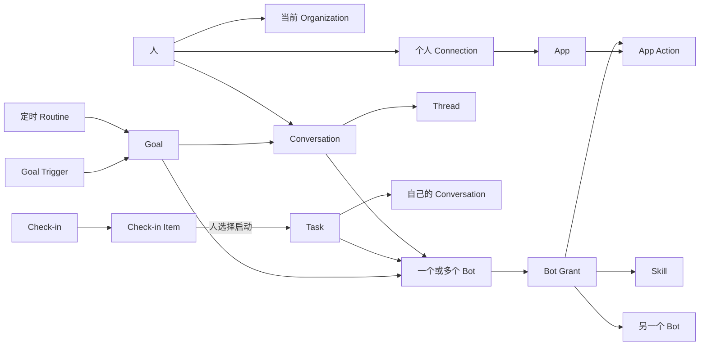

# 领域模型

这是逻辑关系图，不是数据库 ER 图：连线表示业务关联，不推断外键、级联约束或表结构。

证据：[Bot](../../app/src/lib/api/generated/model/bot.ts)、[Conversation](../../app/src/lib/api/generated/model/conversation.ts)、[Task](../../app/src/lib/api/generated/model/task.ts)、[Goal](../../app/src/lib/api/generated/model/goal.ts)、[Routine](../../app/src/lib/api/generated/model/routine.ts)、[BotGrant](../../app/src/lib/api/generated/model/botGrant.ts)。这些类型由 API 生成，属于契约；[planRoutine](../../app/src/lib/routines/plan.ts) 和 [createFromPlanMutationOptions](../../app/src/lib/routines/mutations.ts) 体现对象的实际前端组合。

## 身份、可见性与运行载体

| 概念 | 与其他概念的区别 | 证据 |
| --- | --- | --- |
| Bot | 面向人的 AI 同事身份；角色、权限、模型和运行框架是其不同方面 | [Bot](../../app/src/lib/api/generated/model/bot.ts) |
| Harness | 运行 Bot 的框架；目录声明其入口、凭据需求和可创建性 | [Harness catalogue](../../shared/harnesses.ts) |
| Public / Private | 组织内共享范围；不是管理权限 | [BotVisibility](../../app/src/lib/api/generated/model/botVisibility.ts) |
| Isolated Bot | 请求独立计算机；`isolated` 是配置意愿，`isolationActive` 是当前实际生效状态 | [Bot](../../app/src/lib/api/generated/model/bot.ts)、[隔离提示](../../app/src/lib/agents/isolation.ts) |
| hidden / pinned | 某个人对列表的显示偏好；隐藏不撤回授权 | [grantRoster](../../app/src/lib/agents/grant-roster.ts) |

## 对话与工作的层次

Conversation 是协作场所，Thread 是承载消息与执行历史的载体。Task 有自己的 Conversation，并可通过 `originConversationId` 关联原对话；Goal 也关联 Conversation 和记录其运行的 Thread。不能用一次 Run 的结束推断 Task 或 Goal 已完成。

有三种不同的工作拆分：自己的 Task（[orchestration](../../shared/orchestration.ts)）、同一个 Bot 的 Subagent（[subagent](../../shared/subagent.ts)）、转给另一个 Bot（[BotHandoff](../../app/src/lib/api/generated/model/botHandoff.ts)）。它们具有不同权限和结果回传边界。

Routines 是统一页面，也是狭义定时 Routine 的名字。页面将 Routine、Goal、Check-in 合并展示；关联 Goal 的 Routine 作为该 Goal 的启动方式，不另列重复行。证据：[MergedRoutine](../../app/src/lib/routines/merged.ts)。

## 应用与授权的三层

1. App 声明可提供的 Action。
2. Connection 指定人以哪个应用账户操作；共享账户则由 OpenBot 共同持有。
3. Bot Grant 指定某个 Bot 可以使用的 Action、Skill 或另一个 Bot。

共享账户还有 Shared-use Approval，规定可指示该 Bot 的人群及是否允许外部输入启动的执行。这些关系不能合并成单一“已连接”状态。证据：[App](../../app/src/lib/api/generated/model/app.ts)、[Connection](../../app/src/lib/api/generated/model/connection.ts)、[Grant kinds](../../app/src/lib/api/generated/model/botGrantKind.ts)、[SharedUseApproval](../../app/src/lib/api/generated/model/sharedUseApproval.ts)。

## 记忆与学习

| 对象 | 归属或联系 |
| --- | --- |
| Memory | 关于某个人的事实；Bot 形成的记忆带形成者，来源导入的记忆关联 Memory Source |
| Memory Source | 对某项 App 读取动作的配置，指定读取它的 Bot |
| Recording | 人的操作示范，可作为学习证据 |
| Learning Proposal | 新增、更新或移除技能的提案，包含文件和支撑洞见 |
| Insight | 经验判断、影响和证据的组合 |
| Learned Skill | 学习空间发布的技能内容，受审核和共享设置约束 |

证据：[Memory](../../app/src/lib/api/generated/model/memory.ts)、[MemorySource](../../app/src/lib/api/generated/model/memorySource.ts)、[Learning 类型](../../shared/learning.ts)、[录制类型](../../shared/recorder-api.ts)。手工配置的斜杠 Skill 与学习发布的 Skill 使用不同的数据表示，不能假设二者字段或发布流程相同。
