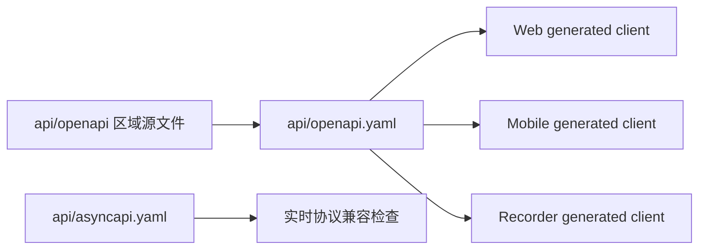

# 工程约束与兼容

本页记录从仓库配置和代码得到的维护约束。完整安装、测试、发布步骤分别见 [Development](../development.md)、[API](../../api/README.md)、[Releasing](../releasing.md)。

## 单一来源与生成链

区域 API 是编辑入口，bundle 和客户端是生成产物。根脚本 `api:generate` 先 bundle，再运行三个客户端的 Orval 配置。CI 检查 bundle/client 漂移、API 约定及相对基线的破坏性变化。证据：[package.json](../../package.json)、[Web Orval](../../app/orval.config.ts)、[CI](../../.github/workflows/ci.yml)、[API 指南](../../api/README.md)。

API 写操作使用 Idempotency-Key；当前前端为一次新的业务写生成新 key。重试同一次写应复用原 key，但重新按 Create 发起的操作可能是新写；因此不确定保存不能仅靠再次点击来恢复。证据：[idempotencyKey](../../app/src/lib/api/request.ts)、[例行安排补偿](../../app/src/lib/routines/mutations.ts)。

## 多语言共享契约

| 内容 | 单一来源 | 维护意义 |
| --- | --- | --- |
| Harness 名称及接入元数据 | [harnesses.json](../../shared/harnesses.json)、[TS 类型](../../shared/harnesses.ts) | 不同语言读取同一目录，避免安装器和 Web 选项漂移 |
| Goal / Routine 的模型消息与解析 | [responsibility-turn](../../shared/responsibility-turn.ts)、[routine-firing](../../shared/routine-firing.ts) | 发送文案也是历史消息识别契约 |
| 动作未执行的原因 | [approval-outcomes](../../shared/approval-outcomes.ts) | 模型答案与给人的解释对应 |
| 持续许可是否可提供 | [standing-rule](../../shared/standing-rule.ts) | 卡片显示和服务端拒绝约定一致 |
| Subagent 与委派协议 | [subagent](../../shared/subagent.ts)、[orchestration](../../shared/orchestration.ts) | 工具名、结果和卡片识别对应 |
| 录制范围与目的地 | [recorder-disclosure](../../shared/recorder-disclosure.ts) | 多入口使用同一披露内容 |

对模型发送的固定文本可能也被 UI 解析。改文案时检查识别器和已有记录兼容，不能把它当作纯显示文案。

## 已确认的旧名称映射

| 旧称或内部称呼 | 当前产品概念 | 证据 |
| --- | --- | --- |
| ResponsibilityRecord / responsibility | Goal | [显式类型别名](../../app/src/lib/responsibilities.ts) |
| ProactiveSetting | Check-in | [proactive](../../app/src/lib/proactive.ts) |
| ProactiveSuggestion | Check-in Item | [proactive](../../app/src/lib/proactive.ts) |
| agentIds / lastMessageAgentId | API 的 botIds / lastMessageBotId | [channelOf 等适配函数](../../app/src/lib/channels/queries.ts) |
| `/agents`、`/agents?agent=...` | `/bots` 或指定 Bot 页面 | [legacyAgentsTarget](../../app/src/lib/agents/legacy-routes.ts) |
| `/responsibilities` | `/routines` | [LEGACY_PAGES](../../app/src/lib/agents/legacy-routes.ts) |
| `/approvals` | `/settings/approvals` | 同上 |
| `/reachability` | `/settings/notifications` | 同上 |
| `/group/new` | `/channel/new` | 同上；新对话选择多个 Bot |

旧名称可能在缓存 key、历史消息、工具结果或协议字段中继续使用。统一产品用词不等于全库机械重命名；兼容路径需逐项核验。

## 发布与升级的设计入口

[ReleaseManifest](../../shared/release-manifest.ts) 将发行身份、源码来源、带摘要的制品、兼容版本和恢复方式显式建模。`parseReleaseManifest` 检查输入，`planUpgrade` 根据已安装状态和策略给出是否允许、原因、停机与恢复信息；模型中有 `restart-previous` 和 `restore-backup`，不能把所有升级都当成换回旧镜像即可恢复。

发布入口见 [release scripts](../../scripts/release-prepare.ts)、[CI gate](../../scripts/release-ci-gate.ts)、[发布 workflow](../../.github/workflows/publish-release.yml)。源码合并与部署升级分别由 [upstream-upgrades](../upstream-upgrades.md)、[local-updates](../local-updates.md)、[kubernetes-upgrades](../kubernetes-upgrades.md) 说明，本次不重复生成完整运行手册。

## 验证与本次提取的限制

修改可执行行为时按现有开发文档选择格式、类型、相关测试及构建；API 改动还需重新生成与兼容检查。本次仅新增设计文档及修正文档导航，不改变产品代码，因此只检查 Markdown 链接、文档结构、状态名称与证据对应，不启动服务或宣称端到端验证通过。
