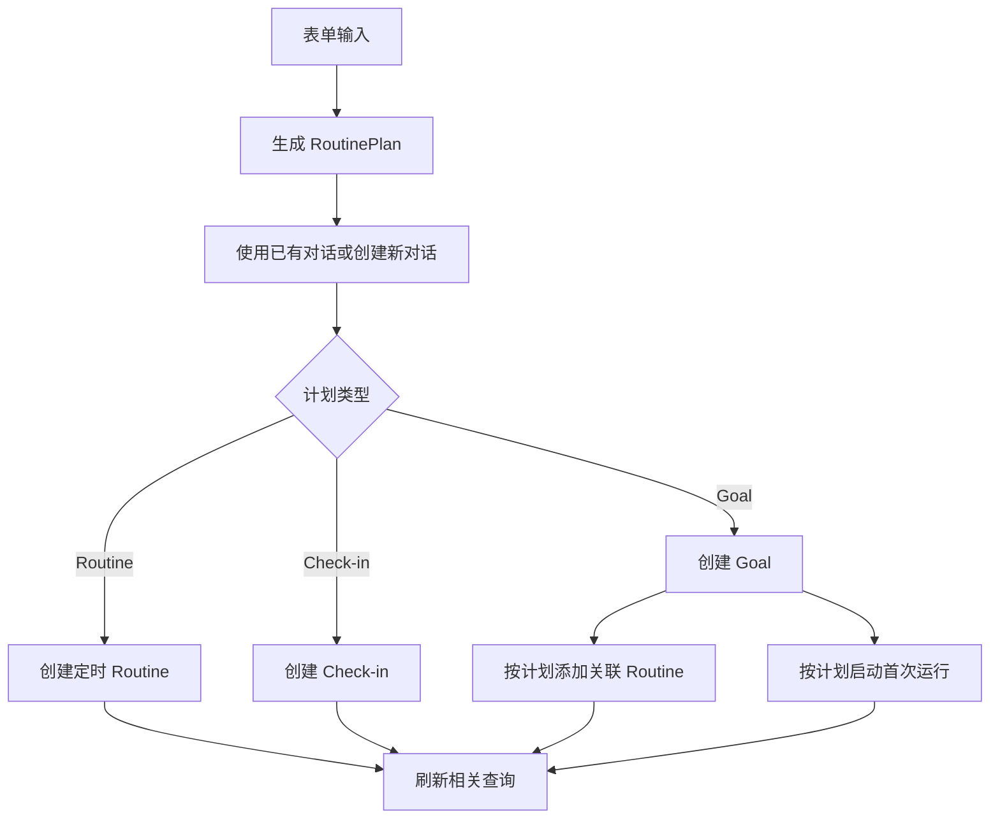

# 核心业务流程

本页将本地可读的前端及 harness 实现，与 API 声明的后端行为分开。运行中的队列、事务和重试调度不在本次代码核验范围内。

## 创建例行安排

表单先生成计划，再由 mutation 执行。`planRoutine` 是分支的单一实现：

| 用户选择 | 生成的计划 |
| --- | --- |
| 只告诉我 | Check-in，记录关注事项、范围和间隔 |
| 定时执行，没有完成标准 | 狭义 Routine |
| 定时执行，有完成标准 | Goal + 关联的定时 Routine，达标结束 |
| 按事件执行，没有完成标准 | 订阅事件的 recurring Goal |
| 按事件执行，有完成标准 | 订阅事件、达标结束的 Goal |
| 立即执行 | Goal + 首次运行；有完成标准则设 endsWhenMet |

证据：[planRoutine](../../app/src/lib/routines/plan.ts)。这里描述表单生成的计划，不声称其他 API 调用方只能创建这些组合。

### 部分成功和不确定结果

创建 Goal 不是一次原子的前端请求：可能依次创建对话、Goal、定时 Routine、首次 Run。实现用 `saved()` 跟踪是否已保留业务记录，并区分明确拒绝与结果不确定：

- 定时 Routine 遭 4xx 拒绝：尝试删除刚创建的 Goal；成功后可清理新对话并重试。
- 删除 Goal 也失败：保留记录，并尝试暂停 Goal；用 `SavedButRefused` 引导人检查已保存的工作。
- 超时、断线或 5xx：不能断言未保存，保留对话并提示先检查，避免再次创建造成重复。
- 无明确保留且是明确拒绝时，新创建的对话会尝试清理；清理失败不覆盖原错误。

证据：[withConversation / createFromPlanMutationOptions](../../app/src/lib/routines/mutations.ts)。这是一套前端补偿流程，不能据此推断后端存在跨请求事务。

## Check-in → Item → Task

Check-in 配置指定 Bot、对话、关注范围和检查间隔。运行发现需要人关注的事项后形成 Check-in Item；人选择 Start，API 才将其交给 Bot，在专属对话中作为 Task 处理；Hide 则移出开放列表。

前端把 Check-in 配置和发现项分别查询；启动事项后会刷新任务相关数据。Run now 返回 queued 或 skipped 等受理信息，不能当成已完成检查。证据：[proactive](../../app/src/lib/proactive.ts)、[Schedules API](../../api/openapi/schedules.yaml)、[Task](../../app/src/lib/api/generated/model/task.ts)。事项生成及执行调度本身属于服务端契约。

## 对话 → 委派工作 → 结果回传

Bot 的共享指令将行为分成直接回答、反应确认、委派工作；委派使用自己的 Task 线程，结果回到原对话。对话自身的 Goal、Routine 和 follow-up 在原对话配置。证据：[orchestration](../../shared/orchestration.ts)。这是模型指导与工具契约，不能保证模型每次都正确选择。

用户显式选择 Bot 时，`startWithChosen` 发出选择记录，再启动对话；记录失败被忽略，不阻断用户已经作出的选择。证据：[channels/start](../../app/src/lib/channels/start.ts)。

Subagent 是另一条路径：同一个 Bot 的独立执行返回答案，或返回需由父 Bot 在对话处理的受审批动作；它不等于向另一个 Bot 转交。证据：[SubagentResult](../../shared/subagent.ts)。

## Harness 工具调用

1. 从请求取得本轮工具、服务端工具集合和 assertion。
2. 模型没有工具调用时结束；工具名未提供或混有调用方拥有的工具时也返回调用方处理。
3. 仅服务端拥有的工具调用可进入本地 tools 节点；执行边界再次核对。
4. 工具通过签名 callback 交回部署，而非由 harness 自行调用 App 厂商。
5. LangGraph 中计算机调用按列表顺序执行；其他调用可以并行，结果再按原调用顺序排列。

证据：[next_step / _call_tool / execute_tools](../../agent-langgraph-agui/src/tool_runtime.py)。首错后停止的全链路保证尚未验证，见 [提取范围](README.md#已发现的差异及核验范围)。

## 记忆与自动学习

Memory Source 指定读取事实的 Bot、App Action 和参数；读取形成的事实有来源、审核状态和启用状态。前端分别管理事实和来源，不把同步成功等同于人已接受事实。证据：[memory](../../app/src/lib/memory.ts)、[Memory](../../app/src/lib/api/generated/model/memory.ts)。

学习流程的可见契约是：对话或录制作为材料 → 带证据的 Insight → Skill 变更 Proposal → 批准或拒绝 → 可读取的发布技能。个人审核、自动批准、共享范围是独立设置。算法内部如何生成或合并洞见不在本仓库实现中。证据：[LearningProposalDetail / PersonalReview / PersonalLearningSharing](../../shared/learning.ts)、[已有自动学习文档](../automatic-learning.md)。

## 切换组织

读取组织列表 → 采用 active 或先设置有效组织 → 允许业务请求；切换时服务端先切会话 → 页面离开旧上下文 → 本地改变组织并清理缓存。组织列表查询还支持跟随其他窗口的切换。证据：[organizations](../../app/src/lib/organizations/queries.ts)、[mutations](../../app/src/lib/organizations/mutations.ts)、[缓存隔离](../../app/src/query-client.ts)。
