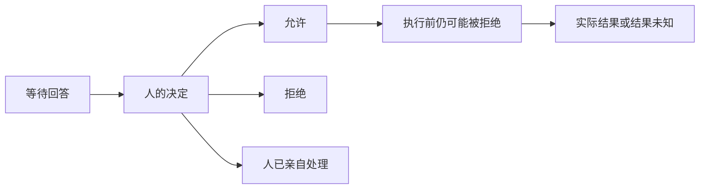

# 生命周期

以下枚举来自 API 契约或共享类型。仅记录有操作或实现证据的状态变化，不将全部枚举值连成假定的完整状态机。

## Goal 与启动方式

| 状态 | 含义 |
| --- | --- |
| `active` | 可以接受运行请求 |
| `paused` | 暂停，任何启动方式都不得运行它 |
| `completed` | 已完成，不再运行 |

`pauseGoal` 暂停，`resumeGoal` 恢复有效，`completeGoal` 完成并关闭关联 Routine。API 没有单独的 reopenGoal 操作；不要从 resume 的名称推断 completed 可重新打开。`runGoal` 对暂停和已完成目标拒绝，返回 202 仅表示已接受。

删除 Goal 的契约包括删除其 Trigger 和关联 Routine；前端会刷新相关列表并移除已删除目标的 runs、triggers 缓存。暂停和恢复不会顺便修改 Routine 开关。证据：[API schedules](../../api/openapi/schedules.yaml)、[目标 mutations](../../app/src/lib/responsibilities.ts)。

`recurring` 目标不会因某次运行成功而结束，`endsWhenMet` 表示达标可结束；两者不可同时启用。界面还结合事件订阅、有效 Routine 和有效 Trigger 判断目标是否持续重复。证据：[目标消息](../../shared/responsibility-turn.ts)、[goalCanEnd](../../app/src/lib/routines/merged.ts)、[创建计划](../../app/src/lib/routines/plan.ts)。

## Task

| 状态 | 含义 |
| --- | --- |
| `working` | 正在工作 |
| `needs_input` | 等人输入 |
| `ready_for_review` | 结果等待人阅读 |
| `failed` | 本轮未完成，可按条件重试 |
| `resolved` | 人已标记完成 |

`retryTask` 仅接受 failed，并返回 working；`resolveTask` 标记完成；`reopenTask` 撤回完成标记，回到对话所处状态，不是统一变成 working。完成、重开均保留对话。证据：[Task API](../../api/openapi/conversations.yaml)、[Task mutations](../../app/src/lib/tasks/mutations.ts)。

列表会叠加对话的实时 busy 信号来显示当前工作状态；其排序优先待阅读、待回答、失败，再到工作中和已完成。超过七天的已完成项目不再列出，不代表删除。证据：[Task queries](../../app/src/lib/tasks/queries.ts)、[orderTasks](../../app/src/lib/tasks/groups.ts)。

## Approval：决定与结果分开

契约状态为 `pending`、`approved`、`denied`、`consumed`、`completed`：分别表示等回答、批准、拒绝、开始执行、执行结束。`decision` 是人的答案，`result` 是动作结果，二者独立。

这幅图表达业务阶段，不声称每条分支对应特定数据库更新顺序。证据：[Approval](../../app/src/lib/api/generated/model/approval.ts)、[ApprovalStatus](../../app/src/lib/api/generated/model/approvalStatus.ts)、[ApprovalDecision](../../app/src/lib/api/generated/model/approvalDecision.ts)。

执行结果可能是拒绝、规则变化而撤回、执行前复查拒绝、执行失败或结果未知。结果未知时不能直接重放动作；共享结果文案要求先核实是否已发生。证据：[approval-outcomes](../../shared/approval-outcomes.ts)。

## 定时运行与 Check-in

| 对象 | 状态或开关 | 说明 |
| --- | --- | --- |
| Routine | `enabled` | 暂停保留配置；恢复从后续安排继续；Run now 执行真实工作 |
| Goal Trigger | `enabled` | 停用仍确认收到投递，但不运行；删除则拒绝后续投递 |
| Routine Run | running / waiting / succeeded / failed / skipped | 等审批或回答属于 waiting，不是成功 |
| Goal Run | queued / running / waiting / succeeded / failed / skipped | queued 与实际开始不同 |
| Check-in 最近状态 | idle / running / succeeded / error | 与一次运行是否被跳过的原因分开 |
| Check-in Item | open / started / dismissed / superseded | 人启动、隐藏，或后续检查判定不再需要 |

证据：[Schedules API](../../api/openapi/schedules.yaml)、[RoutineRunStatus](../../app/src/lib/api/generated/model/routineRunStatus.ts)、[GoalRunStatus](../../app/src/lib/api/generated/model/goalRunStatus.ts)、[CheckInLastStatus](../../app/src/lib/api/generated/model/checkInLastStatus.ts)、[CheckInItemStatus](../../app/src/lib/api/generated/model/checkInItemStatus.ts)。

## 记忆、学习和人工接管

- Memory 的审核状态为 `unreviewed`、`confirmed`、`edited`，启用开关独立存在；未审核的事实不参与回忆。见 [Memory](../../app/src/lib/api/generated/model/memory.ts)。
- Learning Proposal 为 `pending_review`、`approved`、`rejected`；个人版还可自动批准，不能假设每个 approved 都经过人工操作。Learning Run 状态为 queued、freezing、batching、reducing、finalizing、succeeded、failed，类型本身不证明所有中间阶段都必经。见 [learning](../../shared/learning.ts)。
- Browser Handoff 状态为 waiting、taken、completed、cancelled、expired、interrupted。控制者 holder 与请求状态分开；请求消失不能证明秘密值已填写，需查看 secretEnded 的 supplied。见 [computer-control](../../shared/computer-control.ts)。
