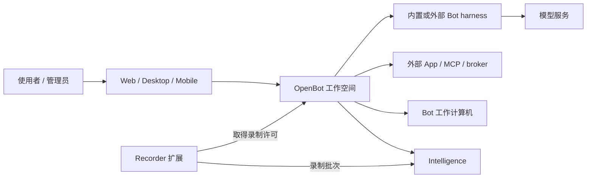
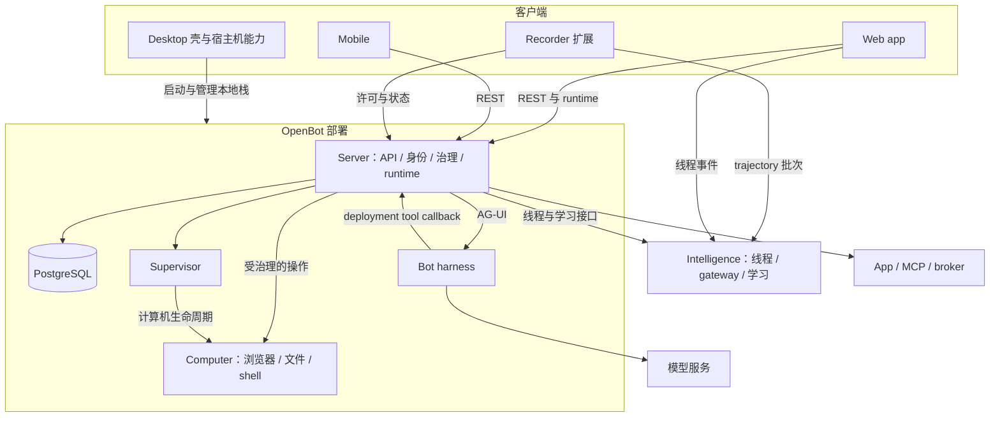
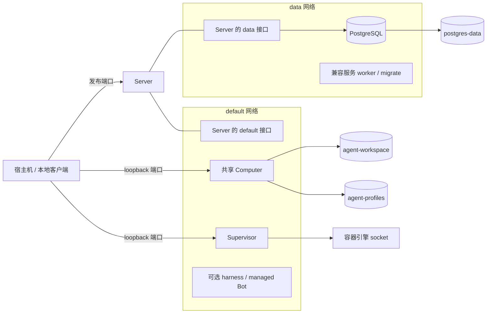

# 系统架构设计

已渲染图像：[交互图集](rendered/index.html) · [渲染与检查说明](rendered/README.md)。

本页从当前仓库的配置、接入代码和协议重建设计。图中的服务端内部职责来自契约或既有说明，不能等同于本次审阅了镜像中的实现。阅读范围见 [证据约定](README.md#证据如何理解)。

## 系统上下文

OpenBot 是产品身份、组织、能力和动作治理的入口；Bot harness 负责承载模型执行；Intelligence 提供线程实时通道及记忆学习相关能力。模型接入和外部应用不是同一层：模型由 harness 及部署模型配置决定，应用动作通常通过 OpenBot 的工具回调路径执行。

证据：[CopilotProvider](../../app/src/lib/copilot/provider.tsx)、[LangGraph main](../../agent-langgraph-agui/src/main.py)、[tool runtime](../../agent-langgraph-agui/src/tool_runtime.py)、[AsyncAPI](../../api/asyncapi.yaml)、[录制声明](../../shared/recorder-disclosure.ts)。

## 容器与职责

这是职责图，不规定网络实际连接必须直达：gateway 可由 server 或部署入口代理，客户端看到同一个域名不表示流量经过同一个服务实现。Web 图中只展开线程通道；屏幕、终端和对话变化另有 WebSocket，见 [数据流程](data-flows.md)。

证据：[Compose](../../docker-compose.yml)、[启动脚本](../../scripts/start.sh)、[API 区域清单](../../api/README.md)、[实时协议](../../api/asyncapi.yaml)。Desktop 的具体安装和平台分支继续见 [Desktop install](../desktop-install.md)。

## 本地 Compose 的网络与存储边界

Server 处于两个网络，PostgreSQL 仅声明 data 网络；不含 networks 声明的其他服务进入 default。网络分离减少 Bot 计算机直接触达数据库的路径，不是对宿主机或容器引擎安全性的完整证明。Supervisor 持有引擎 socket，其访问能力与一般 App API 不同。

Compose 的 `x-openbot-scheduled-work: server` 与启动脚本说明当前由 server 承担迁移及定时工作；`worker`、`migrate` 留作旧版本兼容，不能因为 YAML 定义了它们就画成当前必然运行的独立进程。实际启动服务集合仍受个人版、profile 和配置影响。证据：[Compose](../../docker-compose.yml)、[start.sh 的 SERVICES 与旧容器清理](../../scripts/start.sh)。

本图中的 Computer 是 Compose 中的共享实例；配置 supervisor 后创建的专属实例不由这张静态 Compose 图完整列举。独立计算机的容器、卷和部署方式需结合实际运行环境确认。

## 数据职责划分

| 数据 | 设计中的持有方 | 可确认的来源与限制 |
| --- | --- | --- |
| Bot、App、Grant、审批、审计、例行工作配置 | Server 的产品数据 / PostgreSQL | [既有架构](../architecture.md) 与 API；没有本地 SQL schema 可验证物理表 |
| 对话线程、运行事件、记忆及学习材料 | Intelligence 相关能力 | [AsyncAPI](../../api/asyncapi.yaml)、[learning](../../shared/learning.ts)、[memory](../../app/src/lib/memory.ts)；产品投影不等于后端全部数据 |
| 浏览器登录状态、工作文件 | Computer 的 profile 与 workspace | [Compose volumes](../../docker-compose.yml)、[隔离说明](../../app/src/lib/agents/isolation.ts) |
| 录制待发送批次 | Recorder 本地 outbox | [outbox](../../extension/src/offscreen/outbox.ts)、[streamer](../../extension/src/offscreen/streamer.ts) |
| 页面查询缓存 | 当前客户端，按组织隔离 | [query-client](../../app/src/query-client.ts)；不是产品持久存储 |
| 附件内容与引用 | Server 提供上传/读取，消息保留引用 | [附件上传](../../app/src/components/channels/composer/attachments.ts)、[附件地址](../../app/src/lib/channels/attachments.ts)；不推断物理落盘位置 |

## 哪些图不能仅靠当前工作区还原

- 完整物理数据库 ER 图：没有服务端表定义和 migration，API 关系只能画逻辑模型。
- 队列、锁、事务、重试与故障切换的全部内部时序：类型和调用入口不足以证明实现。
- 实际生产拓扑及容量：Compose 是一种部署描述，不能代替运行中的集群、路由与监控。

可以确认的业务关系见 [领域模型](domain-model.md)，可确认的状态与操作见 [生命周期](lifecycles.md)。
